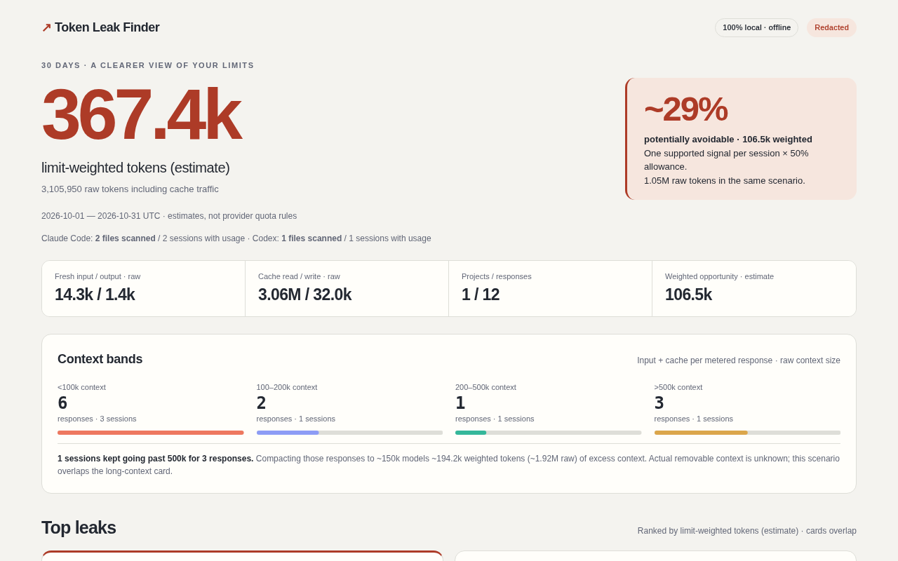

# Token Leak Finder

Find why Claude Code and Codex burn through your limits: a local-only CLI that reads existing session logs and writes one offline HTML report with practical fixes.

## 30-second quickstart

Requires **Node.js 18+** on macOS, Linux, or Windows. No API key, account, or runtime dependencies.

```sh
npx token-leak-finder
npx token-leak-finder --open
npx token-leak-finder --redact --open
```

The first command writes `token-leaks-report.html` in your current directory, using the last **30 days**. `--open` launches your default browser on that local file. Use `--redact` before taking screenshots or sharing output. `token-leaks` is an equivalent executable name.

**Launch status:** this checkout is an unpublished release candidate (`private: true`). The `npx` commands above are the intended public entry point after the first npm release. Until then, [run from source](#development). Fetching the package with npm/npx needs a registry or cache; the installed analyzer runs offline.



[Download the synthetic sample HTML](docs/sample-report.html) and open it locally. The screenshot and sample contain synthetic data only. Reports include their own CSS, JavaScript, and SVG; there are no remote assets.

## What it found on my machine

One real, redacted 30-day scan (these are observations from one machine, not expected savings):

- **3.62B limit-weighted tokens** in 30 days; **27.0B raw**, almost all cache reads.
- **~25.9% likely avoidable**, using the conservative overlap method below.
- Long chats past 150k without compaction: **51.6%** of weighted usage across **524 sessions**. **59 sessions** ran past 500k for **17,782 responses**.
- Idle-session cache rewrites: **2.4%**; MCP schema overhead: **0.9%**; heavy session start: **0.7%**; barely-used MCP servers: **0.5%**.
- Opus/high-reasoning models: **99.8%** of weighted usage, shown separately as a model-choice lever.

Individual categories overlap. A category's percentage is its estimated share of weighted usage, not a proven reduction in provider limits. No real-log report is included here.

## What each leak means

Only positive signals appear. All card amounts and percentages use limit-weighted tokens; raw estimates are shown separately.

| Category | What it means | How it is measured | What to do |
| --- | --- | --- | --- |
| `long_context_no_compaction` | Long chats keep replaying old context. | Only excess above 150k input + cache tokens per response, in uncompacted segments with at least five above-threshold responses; allocate the observed context weights proportionally. | Compact at a checkpoint or start fresh with a short handoff. |
| `resumed_idle_sessions` | Resuming a stale session may rewrite its cache. | Gaps over one hour followed by at least 10k cache-write tokens, weighted ×1.25. Cache expiry is inferred, not proven. | Save a handoff before breaks; start fresh if old context no longer helps. |
| `repeated_file_reads` | The same file enters context repeatedly. | Second and later reads within a session; tool-result text length / 4, one input insertion per repeat, capped by that session's observed weighted context. | Reuse notes; after edits, read the diff or changed lines. |
| `huge_tool_outputs` | Large tool results fill context. | Results above 10k estimated tokens (characters / 4), one insertion each, capped per session. | Narrow queries and ranges; cap output with `head`, `rg -m`, or JSON projections. |
| `mcp_schema_overhead` | Configured MCP schemas may travel with context. | Assume 1,000 raw tokens per configured server per response; use each session's observed context weighting and cap at observed context. Current config may differ from history. | Enable only task-relevant servers. |
| `unused_mcp_servers` | Configured servers were barely used. | Servers with 0–2 observed calls in the window; same assumed schema replay calculation. | Disable optional servers until needed. |
| `big_instruction_files` | Always-loaded rules may be costly. | Instruction files ≥4k estimated tokens (bytes / 4); assume replay per response, weight by the session's context mix and cap at observed context. Upper bound only. | Keep core rules short; load detailed references on demand. |
| `subagent_startup` | Subagents repeat startup context. | First observed fresh input + cache write in sidechain/subagent files, using their respective weights. | Batch related small tasks and pass focused context. |
| `big_baseline_per_session` | Sessions start with heavy overhead. | First observed fresh input + cache write ≥10k raw tokens, weighted by field. May include task context. | Reduce always-loaded tools/rules and redundant startup. |

`expensive_model_share` is a separate **cost lever**, not a leak or headline saving. It shows weighted usage on model names matching `*opus*`, `*:high`, `*:xhigh`, `*:ultra`, or `*:max`; override with repeatable `--top-tier-pattern` globs. Try a mid-tier model or lower reasoning for routine tasks.

The report includes context-size bands, a >500k compaction scenario, daily/project/model usage, MCP inventory, repeat counts, scan coverage, and ready-to-copy fixes. `--rules` writes optional drafts for manual review; it never edits your agent settings. Verify that suggested ignore files and output-cap settings are supported by your installed tool version.

## Privacy

- **Offline and read-only.** The analyzer has no network clients, telemetry, uploads, or network modules. The source-audit test in [`test/edge.test.ts`](test/edge.test.ts) enforces this. The HTML's content security policy disables network connections. Only requested report artifacts are written.
- **No conversation text in reports.** Prompts, replies, reasoning, commands, and tool bodies are not retained in the report model. Tool text becomes lengths; literal shell reads become inferred paths. Default reports retain project/file paths, session identifiers, and tool/model/server names.
- **Config discovery retains MCP names only.** Config values are parsed transiently; arguments, headers, environment values, commands, URLs, and secrets are discarded. Files over 4 MiB are skipped and counted. Instruction files are measured with file stats; their contents are never read.
- **`--redact` applies to HTML, JSON, and rules.** Projects become `project-a`, sessions `session-1`, file paths `project-a/file-1.ts`, and private MCP names `mcp-1` (also inside tool names). Home paths become `~`. Common API-key, GitHub, AWS, Slack, JWT-like, and email patterns are scrubbed from every report string. A small public MCP-name allowlist lives in `src/privacy.ts`.
- Redaction is a heuristic: inspect artifacts before sharing. Tests use synthetic fixtures and private-text sentinels. **Never commit real-log output, even redacted output.** `reports/` stays gitignored.

`--open` only starts a local browser process on a local `file:` URL (`open`, `cmd /c start ""`, or `xdg-open`). The analyzer does not upload or serve the file. Browsers and npm/npx have their own behavior outside the analyzer's network boundary.

## How the numbers work

```text
limit-weighted tokens = fresh input × 1 + output × 5
                      + cache read × 0.1 + cache write × 1.25
```

These are **relative estimates, not provider quota rules, prices, or billing estimates**. Cache replay can make raw traffic much larger than newly written text. Tool/instruction size estimates are diagnostics and are never added to provider usage totals. Weights and thresholds live in `src/config.ts` and are recorded in JSON.

Claude streaming snapshots are merged by message/request ID using per-field maxima. Codex cached input is a subset of input; reasoning is a subset of output. Neither is added twice. Codex cumulative deltas suppress duplicate counters; `last_token_usage` helps with first observations and resets. Modern `token_usage_record` is a fallback when no in-range `token_count` events exist.

A response means one metered API response, not one user message. Sessions are log files, with subagent files counted separately. Project attribution uses the last observed cwd; Windows drive/UNC paths normalize separators and case so equivalent paths group together. Files scanned, sessions with positive usage, tool-only sessions, errors, malformed records, unknown events, and skipped lines are reported separately.

### Avoidable percentage and overlaps

Cards overlap and must not be summed. For each session:

```text
supported = max(weighted excess context, weighted repeated reads,
                weighted huge outputs, weighted idle cache rewrites)
opportunity = min(supported, observed weighted input/cache) × 0.50
headline % = sum(opportunity across sessions) / total weighted usage × 100
```

The **50% actionable allowance** is an explicit assumption: some context and repeated work remain useful. All signals within a session are treated as overlapping; disjoint sessions can contribute independently. JSON `avoidableContributions` records the winning signal and weighted/raw amounts. Raw savings use the same winner and allowance.

Schema/instruction replay, baseline, subagent startup, and model choice are excluded from the headline because removable overhead cannot be inferred reliably. The >500k scenario overlaps long-context findings and is not added again. No percentage promises verified quota savings.

## All flags

| Flag | Default | Purpose |
| --- | --- | --- |
| `--since <window/date>` | `30d` | Hours/days/weeks (`12h`, `30d`, `4w`) or UTC `YYYY-MM-DD`; end is scan start. |
| `--claude-dir <path>` | See paths below | Replace all default Claude roots with this projects directory. |
| `--codex-dir <path>` | See paths below | Replace the default Codex sessions root. |
| `--only claude\|codex` | both | Restrict source. |
| `--project <substring>` | all | Case-insensitive cwd filter; Windows separators are normalized. |
| `--out <path>` | `./token-leaks-report.html` | HTML destination. |
| `--open` | off | Open the saved local HTML file in your default browser. |
| `--json [path]` | off | Aggregate JSON; omitted path: `./token-leaks-analysis.json`. `--json -` sends JSON to stdout and summary to stderr. |
| `--rules [path]` | off | Suggested drafts; omitted path: `./suggested-rules.md`. |
| `--redact` | off | Alias identifiers/paths and scrub common secret patterns. |
| `--max-line-bytes <n>` | `8388608` | Skip oversized physical lines before buffering; maximum 256 MiB. |
| `--concurrency <n>` | `4` | File workers, 1–16. |
| `--huge-output-tokens <n>` | `10000` | Large-result threshold. |
| `--context-threshold <n>` | `150000` | Compaction checkpoint. |
| `--top-tier-pattern <glob>` | Opus/high-reasoning globs above | Repeat to replace defaults; case-insensitive, `*` wildcard. |
| `--home-dir <path>` | OS home | Override config/instruction discovery home for fixtures; does not change log roots or override environment variables. |
| `--help`, `-h` | | Show help. |
| `--version`, `-v` | | Show version. |

Paths resolve from the current directory; quote paths containing spaces. Terminal output uses plain text, including with `NO_COLOR` or redirected output. Progress goes to stderr. The final line shows weighted usage, the avoidable estimate, the top leak, and the report destination.

```sh
npx token-leak-finder --since 7d --only codex --project my-project --open
npx token-leak-finder --redact --out reports/mine.html --json reports/mine.json --rules reports/rules.md
```

When no log files are found in the time window, the CLI exits successfully with searched paths and setup guidance; it writes no report and does not launch a browser. `--json -` still emits an empty aggregate JSON object. Empty or unmatched usage in existing files produces a report with scan coverage. Invalid flags and read/write failures exit with code 1; unreadable individual files are counted in coverage.

## Platforms, paths, and environment variables

Node **18/20/22** on **macOS, Linux, and Windows** are covered by the CI matrix. Defaults use `os.homedir()` and native path joins, including Windows home directories.

| Source | Log discovery | Config discovery |
| --- | --- | --- |
| Claude Code | If `CLAUDE_CONFIG_DIR` is set, scan `projects` under each comma-separated config directory. Otherwise scan `~/.claude/projects`, plus `~/.config/claude/projects` when it exists. Includes subagent `.jsonl` files recursively. | `~/.claude.json`, each selected config directory's `settings.json`, and each observed project's `.mcp.json`. |
| Codex | `$CODEX_HOME/sessions` if set, otherwise `~/.codex/sessions`. Recursively reads `rollout-*.jsonl`. | `$CODEX_HOME/config.toml`, otherwise `~/.codex/config.toml`. |

Global instruction sizes come from selected Claude config directories' `CLAUDE.md` and the Codex home's `AGENTS.md`; project sizes include `CLAUDE.md`, `AGENTS.md`, and `.claude/CLAUDE.md`. Comma-separated Claude config roots are scanned once per physical log, including overlapping roots. Explicit `--claude-dir` / `--codex-dir` flags override environment **log roots**; config lookup still follows the environment/home rules. Browsers require a local graphical session; open the file manually if your environment cannot launch one.

Files are prefiltered by modification time, then event timestamps; future events and untimed usage are excluded. Source directories, `.jsonl` logs, and known instruction/config files are protected against report overwrites. Outputs use atomic writes and owner-only permissions where the OS supports them.

## FAQ and limitations

**Is this my actual bill or remaining quota?** No. It estimates relative context pressure from local usage counters. It cannot prove cache expiry, current limits, prices, or removable context.

**Why do Claude and Codex look different?** Claude reports cache reads/writes separately and may repeat streaming snapshots. Codex commonly reports cached input within input, reasoning within output, and cumulative counters. The parsers normalize those differences. Missing counters, historical cumulative-only baselines, mixed Codex formats, and identical last-only counters without turn markers can reduce accuracy.

**Why is usage missing?** Log formats change. Inspect scan coverage, dates, env vars, source roots, and project filters. Unknown events and malformed/oversized lines are counted. Archived/compressed logs are not read. There is no file cap or top-N scan limit; HTML tables are capped for readability, while JSON retains all aggregate rows.

**Are rereads, large outputs, and subagents always waste?** No. Edits can justify rereads; complex work needs context. Shell-read inference recognizes literal `Read`, `cat`, `sed`, and `rg` operands (including literal nested exec commands), not arbitrary scripts or dynamic paths. Multi-file output is divided equally. Estimates may miss work or attribute too much to a file.

**Does it support Cursor or Gemini?** Not yet. v0.1 reads Claude Code and Codex logs only. No provider APIs, tokenizer, persistent database, or cross-source session deduplication are included. Memory is bounded for line buffers/file workers, but aggregate tables grow with the scan.

## Development

```sh
git clone https://github.com/RomeoJuliett/token-leak-finder.git
cd token-leak-finder
npm ci
npm test
node dist/src/cli.js --redact --open
```

`npm test` builds and runs `node:test` on synthetic fixtures. `npm run demo` generates synthetic logs and writes ignored demo artifacts in `reports/`. To refresh the checked-in sample:

```sh
npm run build
node dist/test/fixtures/generate.js
node dist/src/cli.js --since 30d --redact --claude-dir test/fixtures/data/claude --codex-dir test/fixtures/data/codex --home-dir test/fixtures/data/home --out docs/sample-report.html
```

Clear `CLAUDE_CONFIG_DIR` and `CODEX_HOME` when generating fixtures so all config discovery stays synthetic. `npm run test:package` packs and installs a tarball into a temporary directory, checks the file whitelist and both executable links, and runs a redacted fixture scan offline. See [CONTRIBUTING.md](CONTRIBUTING.md), [SECURITY.md](SECURITY.md), and the [launch checklist](docs/LAUNCH-CHECKLIST.md).

## Roadmap

- Explicit format-version coverage and synthetic examples for newer logs.
- Measured MCP schema-size metadata where safely available.
- Per-response cwd attribution and better shell-read inference.
- Incremental local scans for large histories.
- Cursor/Gemini parsers once privacy-preserving fixtures are available.

## License

[MIT](LICENSE) © 2026 Reco Jefferson.
